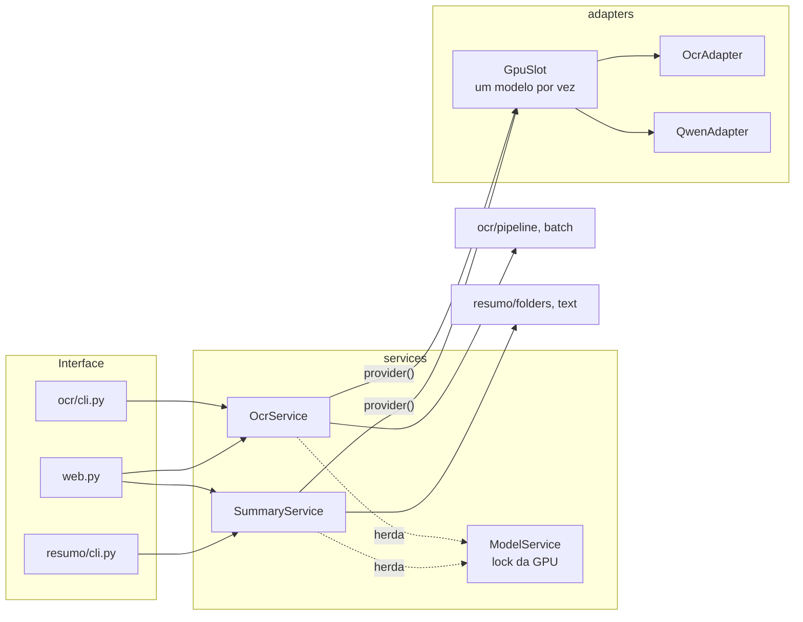
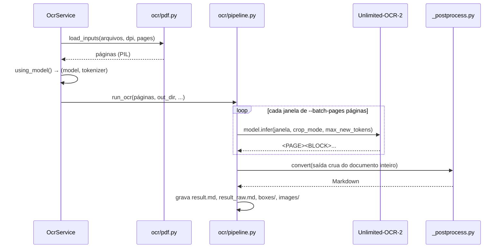
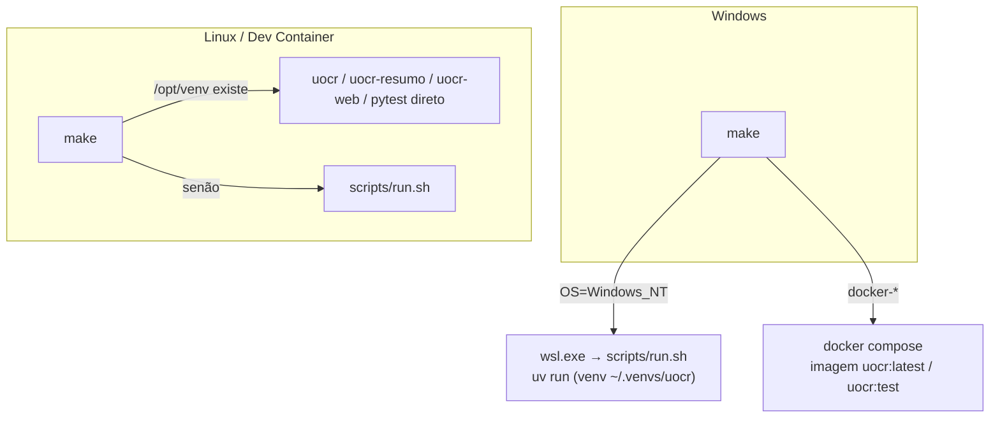

# Arquitetura

O código fica em `uocr/` e está dividido em **camadas compartilhadas** (`adapters`, `services` e `core`) e **domínios** (`ocr` e `resumo`). As camadas trazem o que é igual para os dois modelos. Os domínios têm só a lógica de cada tarefa.

```text
uocr/
├─ adapters/          COMO carregar cada modelo numa GPU pequena
│  ├─ base.py         ModelAdapter, GpuSlot, bnb_config            (comum)
│  ├─ ocr.py          OcrAdapter: Unlimited-OCR-2
│  └─ resumo.py       QwenAdapter + Summarizer: Qwen2.5-7B-Instruct
├─ services/          O QUE fazer com o modelo (usados pela CLI e pela web)
│  ├─ base.py         ModelService + lock da GPU                   (comum)
│  ├─ ocr.py          OcrService: documento e lote .zip
│  └─ resumo.py       SummaryService: um _resumo.md por pasta
├─ ocr/               domínio do OCR
│  ├─ pdf.py          entradas -> páginas (PDF, EXIF, --pages)
│  ├─ pipeline.py     páginas -> modelo em janelas -> Markdown, layout, figuras
│  ├─ batch.py        .zip -> um .md por arquivo, espelhando as pastas
│  ├─ _postprocess.py conversão oficial (cópia do upstream, MIT)
│  └─ cli.py          comando `uocr`
├─ resumo/            domínio do resumo
│  ├─ text.py         limpeza, divisão em partes, prompts, map-reduce
│  ├─ folders.py      percorre as pastas e grava os _resumo.md
│  └─ cli.py          comando `uocr-resumo`
├─ core/              infraestrutura
│  ├─ hub.py          modelos do cache local (offline) e `make baixar`
│  ├─ gpu.py          liberar memória, relatório de VRAM
│  └─ util.py         ordem natural, callback de progresso
└─ web.py             comando `uocr-web`: só interface, chama os services
```

As dependências seguem um sentido só: **interface (CLI/web) → services → domínio + adapters → core**. Os domínios não conhecem a interface, e os adapters não conhecem os services.



## Adapters: carregar um modelo

[`adapters/base.py`](../../uocr/adapters/base.py) concentra o que é igual em qualquer modelo do Hugging Face:

| `ModelAdapter` faz | Detalhe |
| --- | --- |
| Valida a quantização | cada subclasse diz quais aceita (`quant_choices`) |
| Exige CUDA | erro claro se a GPU não for vista |
| Resolve o modelo offline | `core.hub.local_model_path`: pasta do cache, sem rede |
| Carrega sob demanda e guarda | `load()` devolve o mesmo objeto até `unload()` |
| Libera a GPU | `unload()` + `gc` + `torch.cuda.empty_cache()` |

Cada modelo só implementa `_build(path)`:

- [`OcrAdapter`](../../uocr/adapters/ocr.py) devolve `(model, tokenizer)` do Unlimited-OCR-2. A quantização (`4bit`/`8bit`) atinge **só** os experts do MoE (~2,5 B dos ~3,3 B parâmetros). Visão, atenção, embeddings e `lm_head` ficam em bf16 (`SKIP_MODULES`), porque os kernels Triton e o roteador (DASH) precisam disso. No `offload`, cada expert das últimas `--offload-layers` camadas vai para a CPU como uma entrada separada do `device_map`.
- [`QwenAdapter`](../../uocr/adapters/resumo.py) devolve um `Summarizer`, que sabe contar tokens e gerar com o template de chat. Para caber em 6 GB:
  - tudo em NF4, **inclusive o `lm_head`** (`llm_int8_skip_modules=[]`);
  - a tabela de embeddings (152k × 3584, ~1 GB) vai para a **CPU**. Dois hooks levam os ids para a CPU antes da busca e devolvem os vetores à GPU depois;
  - isso só vale para modelos com embeddings separados do `lm_head`, como o 7B. Nos Qwen2.5 ≤ 3B, que compartilham a matriz, nada disso é aplicado.

**`GpuSlot`:** OCR (~4 GB) e Qwen (~4 GB) não cabem juntos em 6 GB. O `GpuSlot` recebe os dois adapters e, quando um é pedido, descarrega o outro. A web usa um slot com os dois. Cada CLI usa um slot com um só adapter, o que dá a mesma mensagem de carregamento e o mesmo relatório de VRAM.

## Services: executar a tarefa

[`services/base.py`](../../uocr/services/base.py) define o `ModelService`:

- **Provider em vez de modelo:** o serviço recebe uma função que devolve o modelo pronto (`GpuSlot.provider(adapter)`). Assim, as entradas são validadas **antes** de carregar qualquer coisa: um PDF inválido ou uma pasta sem `.md` dá erro na hora, sem esperar 1–2 min de carga.
- **Lock da GPU:** `using_model()` reserva a GPU (um `RLock` global), carrega o modelo se preciso e o entrega. Duas tarefas, inclusive de abas diferentes da web, nunca disputam a GPU, e a troca de modelo acontece dentro do lock.

| Serviço | Métodos | Opções |
| --- | --- | --- |
| [`OcrService`](../../uocr/services/ocr.py) | `document(paths, out_dir)`, `batch(zip, out_dir)` | `OcrOptions`: dpi, pages, batch_pages, mode, tokens_per_page, stream |
| [`SummaryService`](../../uocr/services/resumo.py) | `summarize(folder)` | `SummaryOptions`: max_input_tokens, max_new_tokens, instruction, force |

A CLI e a web montam essas opções a partir dos argumentos ou dos campos da tela e chamam o mesmo método. A lógica não é repetida.

## Domínio: OCR



- **Janelas:** no máximo `--batch-pages` páginas por chamada, o que limita a VRAM. O `convert()` roda **uma vez**, no documento inteiro, e por isso tabelas e parágrafos que atravessam janelas continuam unidos.
- **Limite de tokens:** `tokens_per_page × páginas da janela`. A anti-repetição usa `no_repeat_ngram_size=35`.
- **Silêncio:** o debug do código remoto do modelo (`[DASH]`…) é suprimido, exceto com `--stream`. Se o modelo devolver um número de `<PAGE>` diferente do enviado, sai um aviso.
- **Figuras:** os recortes usam o mesmo nome que o `convert()` põe no Markdown (`pageN_x1_y1_x2_y2.jpg`).
- **Lote** ([`ocr/batch.py`](../../uocr/ocr/batch.py)): lê cada entrada direto do zip e roda o pipeline numa pasta temporária. Depois espelha o `.md` e as figuras (`<nome>_images/`) no destino. Os erros de cada arquivo, inclusive falta de VRAM, vão para o `_relatorio.txt`. Regras em [Saída](Saida.md#lote-zip).
- **`_postprocess.py`:** cópia literal do upstream. **Não edite.** Para atualizar, copie de novo e rode os testes. O pipeline também usa as funções internas `_parse_blocks`, `_base_type`, `_scale` e `IMAGE_LABELS`.

## Domínio: resumo

```mermaid
flowchart TB
    A[SummaryService.summarize pasta] --> B[folders.find_folders<br/>pastas com .md diretos]
    B --> C{_resumo.md mais novo<br/>que os .md?}
    C -- sim, sem --force --> D[pula]
    C -- não --> E[text.summarize_texts]
    E --> F{cabe em<br/>max_input_tokens?}
    F -- sim --> G[1 chamada: resumo final]
    F -- não --> H[resumo de cada parte<br/>parciais curtos]
    H --> I{parciais cabem<br/>juntos?}
    I -- não --> J[junta em grupos] --> I
    I -- sim --> K[junção final]
    G --> L[folders.write_summary<br/>pasta/_resumo.md]
    K --> L
```

- **Sem resumo geral:** cada pasta resume só os próprios `.md`. Subpastas não entram no resumo da pasta-mãe, e uma pasta sem `.md` diretos não ganha resumo. Ficam de fora: `_resumo.md`, pastas `*_images` e pastas ocultas.
- **Limpeza** (`clean_markdown`): tira os links de figuras e converte as tabelas HTML em `a | b |`, o que economiza tokens.
- **Divisão** (`pack`/`split_text`): agrupa arquivos inteiros enquanto couberem no orçamento. Um arquivo grande é partido por parágrafo, depois por linha e, em último caso, por caracteres.
- **Map-reduce:** os resumos parciais são limitados a `min(512, orçamento/4)` tokens, então cada rodada de junção encolhe o texto e o processo termina.
- **Geração:** greedy (`do_sample=False`) com `repetition_penalty=1.05`, para que o mesmo texto dê o mesmo resumo. Se o modelo embrulha a resposta em ` ```markdown `, a cerca é removida.
- **Erros por pasta** (inclusive falta de VRAM) não interrompem as outras pastas.

## Offline

[`core/hub.py`](../../uocr/core/hub.py) troca o id (`baidu/Unlimited-OCR-2`) pela pasta local do cache antes de carregar. O `transformers` então lê direto do disco e nunca consulta o Hub:

1. **Pasta local passada como id:** usa como está.
2. **No cache:** `snapshot_download(local_files_only=True)`, sem rede.
3. **Fora do cache, com internet:** baixa uma vez.
4. **Fora do cache, sem internet ou com `HF_HUB_OFFLINE=1`:** erro mandando rodar `make baixar`.

A `web.py` também desliga a telemetria do Gradio (`GRADIO_ANALYTICS_ENABLED=False`) e do Hub.

## Ambientes de execução



O [`scripts/run.sh`](../../scripts/run.sh) faz três coisas:
- configura o venv do `uv`;
- converte caminhos do Windows com `wslpath`;
- executa `uv run --frozen <comando>` a partir da raiz do projeto.

O [Dockerfile](../../Dockerfile) tem quatro estágios:

| Estágio | Conteúdo |
| --- | --- |
| `base` | Python 3.10 slim, gcc, uv e as dependências de produção em `/opt/venv` |
| `test` | `base` + dependências de dev (pytest, pytest-cov) + `tests/` |
| `dev` | `test` + `git`, `make` e `procps`, para o Dev Container |
| `app` | `base` + o comando `uocr-web`; é a imagem padrão |
