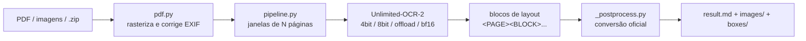

# Unlimited-OCR local: wiki

Wrapper local para o modelo [`baidu/Unlimited-OCR-2`](https://github.com/baidu/Unlimited-OCR). Converte **PDFs, imagens e lotes `.zip` em Markdown**, com tabelas, títulos e figuras recortadas. Depois, **resume cada pasta** do lote com o Qwen2.5-7B. Depois que os modelos são baixados, tudo **funciona offline**. Foi ajustado para rodar em GPUs NVIDIA com pouca VRAM: uma RTX 3060 de 6 GB dá conta.

O modelo usa kernels Triton e por isso só roda em **Linux**. No Windows ele roda pelo **Docker** ou pelo **WSL2**, e o `make` é o ponto de entrada nos dois casos.

## Por onde começar

| Quero… | Página |
| --- | --- |
| Instalar (Docker, WSL2 ou Dev Container) | [Instalação](Instalacao.md) |
| Converter um arquivo ou subir a interface web | [Uso](Uso.md) |
| Entender o que sai em `output/` | [Saída](Saida.md) |
| Resumir as pastas de um lote | [Resumo](Resumo.md) |
| Entender o código | [Arquitetura](Arquitetura.md) |
| Rodar testes, mexer em dependências, cuidar das imagens Docker | [Desenvolvimento](Desenvolvimento.md) |
| Resolver um erro | [Solução de problemas](Solucao-de-problemas.md) |

## Em 30 segundos

```bash
make docker-up                    # Docker: interface web em http://localhost:7860
# ou, sem Docker:
make setup && make                # WSL2: instala uma vez e sobe a interface web
make ocr FILE=C:/docs/contrato.pdf   # CLI: gera output/contrato/result.md
make resumo DIR=output/lote          # um _resumo.md por pasta do lote
```

Para testar sem um arquivo seu, use a foto de exemplo: `make ocr FILE=docs/exemplos/pagina-livro.jpg` (ver [Uso](Uso.md#exemplo-a-foto-de-teste)).

## Visão geral



## Principais recursos

- **Pouca VRAM:** só os experts do MoE são quantizados (4bit/8bit). Visão e atenção ficam em bf16.
- **Documentos longos:** as páginas vão ao modelo em janelas (`--batch-pages`). A conversão para Markdown é feita no documento inteiro, então tabelas e parágrafos que atravessam páginas continuam juntos.
- **Lotes `.zip`:** cada imagem ou PDF vira um `.md` no mesmo caminho. Os arquivos não são extraídos para o disco, e um arquivo com erro não interrompe o lote.
- **Resumo por pasta:** o Qwen2.5-7B (4 bits, embeddings na CPU) grava um `_resumo.md` em cada pasta, sem resumo geral. Pastas grandes são resumidas em partes.
- **Um modelo por vez na GPU:** OCR e resumo não cabem juntos em 6 GB; a web troca sozinha.
- **Offline:** os modelos são carregados do cache local, sem consultar a internet (`make baixar` uma vez).
- **Interfaces:** CLI (`uocr`, `uocr-resumo`) e web (`uocr-web`, Gradio), com abas *Documento*, *Lote (.zip)* e *Resumo*.
