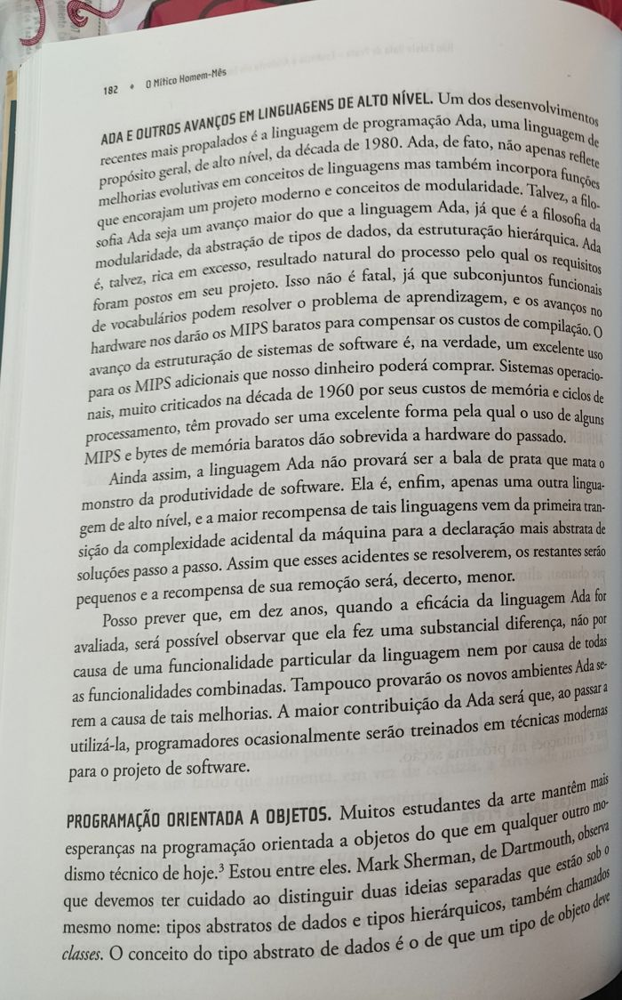
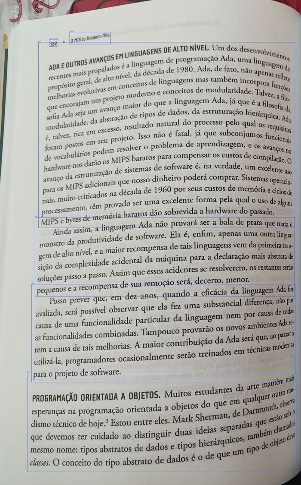

# Uso

## Exemplo: a foto de teste

O exemplo do wiki é uma foto de celular de uma página de livro em pt-br: [`docs/exemplos/pagina-livro.jpg`](../exemplos/pagina-livro.jpg), com 2117×3399 px. Ela tem os problemas típicos de uma foto: página curvada e inclinada, um pedaço da mesa aparecendo e texto do verso vazando pelo papel. Além disso traz cabeçalho, número de página e títulos em caixa alta no meio do texto.

<table><tr>
<td width="50%"><b>Entrada</b><br></td>
<td width="50%"><b>Layout detectado</b> (<code>boxes/page_1.jpg</code>)<br></td>
</tr></table>

```bash
make ocr FILE=docs/exemplos/pagina-livro.jpg     # WSL, Linux ou Dev Container -> output/pagina-livro/
```

No Docker, a CLI só lê de `input/`, então copie a foto para lá antes:

```bash
cp docs/exemplos/pagina-livro.jpg input/
make docker-ocr FILE=pagina-livro.jpg
```

### O que sai

```text
output/pagina-livro/
├─ result.md          # cópia versionada: docs/exemplos/pagina-livro.md
├─ result_raw.md      # cópia versionada: docs/exemplos/pagina-livro_raw.md
└─ boxes/page_1.jpg   # sem images/: a página não tem figuras
```

O modelo achou 6 blocos: `page_number` (182), `header` (o título do livro) e 4 blocos `text`, um por parágrafo. Início do [`result_raw.md`](../exemplos/pagina-livro_raw.md):

```text
<PAGE><BLOCK>page_number[163, 82, 193, 96]<FORK>182
<BLOCK>header[231, 66, 367, 91]<FORK>O Mítico Homem-Mês
<BLOCK>text[128, 87, 977, 470]<FORK>ADA E OUTROS AVANÇOS EM LINGUAGENS DE ALTO NÍVEL. Um dos …
```

No [`result.md`](../exemplos/pagina-livro.md), cada bloco vira um parágrafo:
- **Acentos e hifenização** corretos: "filo-sofia" virou "filosofia".
- **Texto vazado do verso** ignorado.
- **Títulos em caixa alta no meio da linha** ("PROGRAMAÇÃO ORIENTADA A OBJETOS.") ficaram dentro do parágrafo, não viraram `#`, porque o modelo os classificou como texto.
- **Erro na curvatura:** na borda direita, onde a página curva, "desenvolvimentos" saiu como "desenvolvimento".

### Variações para comparar

```bash
make ocr FILE=docs/exemplos/pagina-livro.jpg ARGS="--mode base"   # visão global em vez de tiles
make ocr FILE=docs/exemplos/pagina-livro.jpg QUANT=8bit           # 8bit: mesmo texto, ~3× mais lento
make ocr FILE=docs/exemplos/pagina-livro.jpg ARGS=--stream        # ver o texto sendo gerado
```

## Comandos do `make`

O mesmo `make` funciona no Git Bash, no PowerShell, no shell do WSL e no Dev Container:
- no **Windows**, os alvos locais rodam dentro do WSL pelo `wsl.exe`;
- no **Linux**, rodam direto;
- na **imagem Docker**, usam o venv da imagem.

| Comando | O que faz |
| --- | --- |
| `make` / `make start` | Sobe a interface web em `http://localhost:7860` |
| `make ocr FILE=...` | OCR pela CLI; resultado em `output/` |
| `make stop` | Encerra a interface web que ficou rodando |
| `make resumo DIR=...` | Um `_resumo.md` por pasta de um lote (ver [Resumo](Resumo.md)) |
| `make setup` | Instala o ambiente e baixa os modelos (WSL/Linux, uma vez) |
| `make baixar` | Só baixa os modelos de OCR e de resumo, para uso offline |
| `make test` / `make cobertura` | Testes (sem GPU) / com relatório de cobertura |
| `make docker-up` / `docker-down` / `docker-logs` | Interface web no Docker |
| `make docker-ocr FILE=x.pdf` | CLI no Docker, lendo de `input/x.pdf` |
| `make docker-resumo DIR=lote` | Resumo no Docker, de `output/lote` (com a interface parada) |
| `make docker-baixar` | Baixa os modelos para o volume do Docker |
| `make docker-test` | Testes no Docker |
| `make docker-clean` | Apaga imagens `<none>` do projeto e o cache de build antigo (`CACHE_AGE`, padrão 7 dias) |
| `make help` | Lista tudo |

Variáveis do `make`:

| Variável | Padrão | Uso |
| --- | --- | --- |
| `FILE` | — | Arquivo(s) para `ocr`/`docker-ocr`. Vários: `FILE="a.jpg b.jpg"` |
| `DIR` | — | Pasta para `resumo` (ex.: `output/lote`) ou `docker-resumo` (relativa a `output/`) |
| `ARGS` | — | Opções extras repassadas ao comando, ex.: `ARGS="--pages 1-3"` |
| `QUANT` | `4bit` | Quantização (ver abaixo) |
| `PORT` | `7860` | Porta da interface web |
| `DISTRO` | `Ubuntu-24.04` | Distro do WSL (só no Windows) |

## CLI

```bash
make ocr FILE=C:/docs/contrato.pdf                       # output/contrato/result.md
make ocr FILE=docs/exemplos/pagina-livro.jpg ARGS="--mode gundam"   # imagem com tiles
make ocr FILE=livro.pdf ARGS="--pages 1-20 --batch-pages 4"
make ocr FILE="p1.jpg p2.jpg p3.jpg" ARGS=--combine      # várias imagens = um documento
make ocr FILE=digitalizacoes.zip                         # lote
make ocr FILE=x.pdf QUANT=8bit ARGS=--stream             # 8bit, mostrando o texto ao vivo
```

**Caminhos:**
- os relativos partem da raiz do projeto;
- os do Windows (`C:\...` ou `C:/...`) são convertidos para `/mnt/c/...` pelo [`scripts/run.sh`](../../scripts/run.sh);
- no Git Bash, use `/` ou ponha o caminho entre aspas, porque o bash remove as `\`;
- caminhos com espaços não funcionam no `FILE`: renomeie ou copie o arquivo para a pasta do projeto.

**Sem `make`:**
- dentro do WSL: `bash scripts/run.sh uocr arquivo.pdf`;
- na imagem Docker ou no Dev Container: `uocr arquivo.pdf`.

**Vários arquivos sem `--combine`:** cada um vira uma pasta própria em `output/`. Se dois tiverem o mesmo nome base (`a.pdf` e `a.jpg`), o segundo vira `a_jpg`.

### Opções

| Opção | Padrão | O que faz |
| --- | --- | --- |
| `-o`, `--output` | `output` | Pasta de saída |
| `--quant` | `4bit` | `4bit` / `8bit` / `offload` / `bf16` (ver abaixo) |
| `--offload-layers` | 6 | No modo `offload`: quantas camadas MoE (as últimas) têm os experts na CPU |
| `--batch-pages` | 4 | Páginas por chamada ao modelo. Mais páginas dão mais contexto e usam mais VRAM |
| `--mode` | `auto` | `gundam` divide a página em tiles; `base` usa uma visão global. `auto` usa gundam para 1 página e base para várias |
| `--dpi` | 200 | Resolução ao rasterizar PDFs |
| `--pages` | todas | Páginas do PDF, ex.: `1-3,5`, `10-` |
| `--tokens-per-page` | 8000 | Limite de geração por página |
| `--combine` | — | Junta as entradas (exceto `.zip`) em um único documento |
| `--stream` | — | Mostra o texto enquanto é gerado (com os logs de debug do modelo) |
| `--model` | `baidu/Unlimited-OCR-2` | Outro id do Hugging Face |

### Quantização

| Modo | Como funciona | Quando usar |
| --- | --- | --- |
| `4bit` | NF4 nos experts do MoE; visão, atenção, embeddings e `lm_head` em bf16 | Padrão; o mais rápido em 6 GB |
| `8bit` | Int8 nos mesmos módulos | Referência de qualidade, mas ~3× mais lento |
| `offload` | bf16, com os experts das últimas camadas na CPU | Quando a quantização não é aceitável e a VRAM não basta |
| `bf16` | Modelo inteiro na GPU | GPUs ≥ 10 GB |

Medido numa RTX 3060 Laptop (6 GB), com a [foto de teste](#exemplo-a-foto-de-teste) e 772 tokens gerados:

| Modo | Tempo | Pico de VRAM | Texto |
| --- | --- | --- | --- |
| `4bit` | ~85 s | 4,0 GB | igual ao 8bit |
| `8bit` | ~254 s | 5,2 GB | referência |

A primeira execução de cada processo é mais lenta porque o Triton compila os kernels.

## Interface web

`make` (ou `make docker-up`) e abra `http://localhost:7860`.

- **Aba Documento:** envie um ou mais PDFs/imagens. Eles viram **um** documento. O resultado aparece renderizado (*Markdown*), em texto (*Texto*) e com os blocos desenhados (*Layout*), e pode ser baixado como `.zip`.
- **Aba Lote (.zip):** envie um `.zip` e receba outro com um `.md` por arquivo, mais um relatório do que foi gerado, deu erro ou foi ignorado.
- **Aba Resumo:** escolha um lote já processado e gere um `_resumo.md` por pasta com o Qwen2.5-7B. Ver [Resumo](Resumo.md).
- **Opções** (acordeão no topo): DPI, páginas, páginas por janela, modo de visão e limite de tokens. São as mesmas opções da CLI.

Cada job é gravado em `output/web/<data-hora>_<nome>/`. A GPU processa uma tarefa por vez, de qualquer aba; as outras esperam. Ao trocar entre OCR e Resumo, o modelo atual sai da GPU e o outro entra (~1–2 min).

Opções do `uocr-web`: `--quant`, `--offload-layers`, `--model`, `--summary-model`, `--summary-quant` (padrão `4bit`), `--output` (padrão `output/web`), `--host` (padrão `0.0.0.0`) e `--port` (padrão 7860).

## Variáveis de ambiente

| Variável | Efeito |
| --- | --- |
| `UOCR_QUANT` | Quantização padrão da CLI/web quando `--quant` não é passado |
| `UOCR_MODEL` | Modelo de OCR padrão |
| `UOCR_SUMMARY_MODEL` | Modelo de resumo padrão (`Qwen/Qwen2.5-7B-Instruct`) |
| `HF_HUB_OFFLINE=1` | Garante que nada tenta a internet; um modelo fora do cache dá erro na hora |
| `UOCR_VENV` | Onde fica o venv no WSL (padrão `~/.venvs/uocr`) |
| `PYTORCH_CUDA_ALLOC_CONF` | Padrão `expandable_segments:True` (reduz fragmentação da VRAM) |

O `make` sempre passa `--quant $(QUANT)`. Por isso, pelo `make`, use `QUANT=...` em vez de `UOCR_QUANT`.
